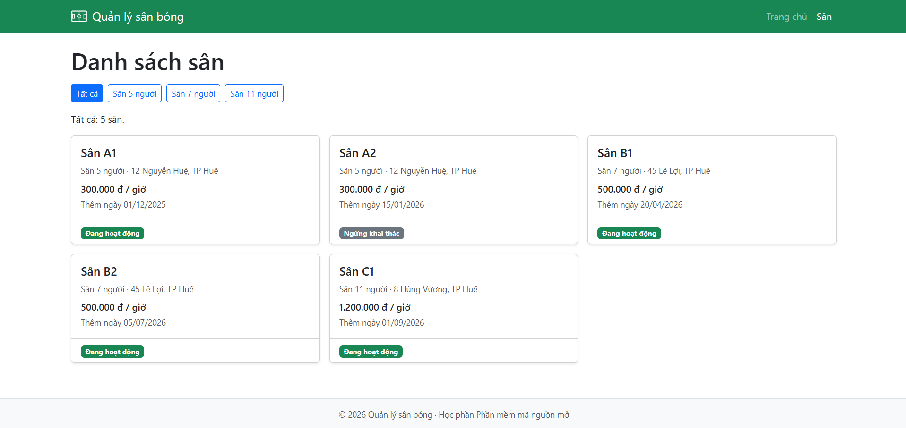
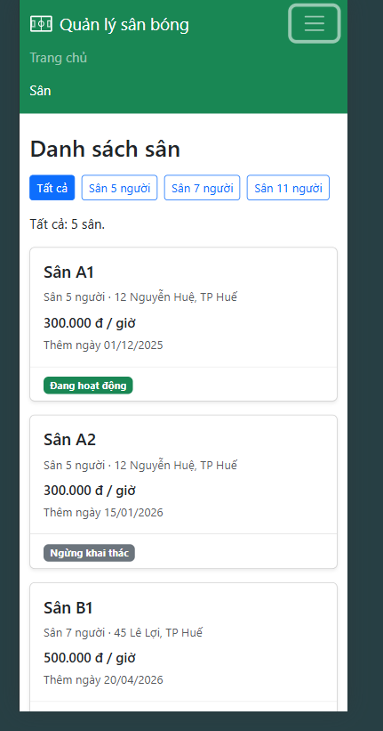

# Hệ thống quản lý sân bóng đá

Web app viết bằng Python (Flask) để quản lý việc cho thuê sân bóng đá:

- Khách xem danh sách sân và lịch trống, đặt sân (giữ chỗ 10 phút, trả cọc 30% dạng mô phỏng), xem và hủy đơn của mình.
- Nhân viên xem lịch theo ngày, check-in, thu tiền còn lại.
- Quản trị viên quản lý sân, giờ mở cửa, bảng giá và xem báo cáo doanh thu.

Đồ án học phần **Phần mềm mã nguồn mở**, Trường Đại học Khoa học, Đại học Huế (GV: Nguyễn Dũng).
Người thực hiện: Nguyễn Văn Quân.

## Trạng thái

**Đang phát triển.** Phiên bản v0.2 (Chương 4): giao diện dùng template Jinja2 kế thừa và Bootstrap 5, hiển thị tốt trên máy tính và điện thoại.

- Trang chủ: tổng số sân, số sân đang hoạt động, 3 sân mới thêm gần đây dạng thẻ.
- Danh sách sân: lưới thẻ 1/2/3 cột, thanh lọc theo loại sân dạng nút.
- Chi tiết sân: bảng thông tin, loại sân là liên kết sang danh sách đã lọc.
- API JSON cho danh sách và chi tiết sân; trang lỗi 404 riêng.

Các bản trước: v0.1 (Chương 3) sinh HTML bằng ghép chuỗi trong `app.py`.

## Công nghệ

| Thành phần | Công nghệ | Giấy phép | Trạng thái |
|---|---|---|---|
| Ngôn ngữ | Python ≥ 3.11 | PSF-2.0 | Đang dùng |
| Web framework | Flask | BSD-3-Clause | Đang dùng |
| Template | Jinja2 | BSD-3-Clause | Đang dùng |
| Phụ thuộc của Flask | Werkzeug, MarkupSafe, click, itsdangerous | BSD-3-Clause | Đang dùng |
| Phụ thuộc của Flask | blinker | MIT | Đang dùng |
| Giao diện | Bootstrap 5.3.3 (nạp qua CDN jsdelivr) | MIT | Đang dùng |
| ORM | SQLAlchemy | MIT | Dự kiến |
| Cơ sở dữ liệu | SQLite | Public domain | Dự kiến |
| Kiểm thử | pytest | MIT | Dự kiến |

Danh sách gói và phiên bản cụ thể nằm trong [requirements.txt](requirements.txt).

## Cài đặt và chạy

Cần có sẵn Python 3.11 trở lên và Git. Các lệnh dưới đây chạy trong PowerShell trên Windows:

```powershell
# 1. Tải mã nguồn về máy (thay <duong-dan-kho-ma> bằng địa chỉ kho trên GitHub)
git clone <duong-dan-kho-ma>
cd quan-ly-san-bong

# 2. Tạo môi trường ảo .venv
python -m venv .venv

# 3. Cài các thư viện cần dùng
.\.venv\Scripts\python.exe -m pip install -r requirements.txt

# 4. Kiểm tra đã cài được Flask
.\.venv\Scripts\python.exe -m flask --version

# 5. Xem danh sách route của ứng dụng
.\.venv\Scripts\python.exe -m flask --app app routes

# 6. Chạy server ở chế độ debug, cổng 8000
.\.venv\Scripts\python.exe -m flask --app app run --debug --port 8000
```

Sau đó mở trình duyệt tại http://127.0.0.1:8000/. Nhấn `Ctrl + C` trong terminal để dừng server.
Bootstrap được tải từ CDN nên máy cần có Internet; không có mạng thì trang vẫn chạy nhưng mất định dạng.
Chế độ `--debug` chỉ dùng khi phát triển trên máy cá nhân, không bật trên máy chủ triển khai.

## Các URL đã kiểm thử

Dữ liệu mẫu có 5 sân, trong đó Sân A2 đang ngừng hoạt động (`INACTIVE`).
Ngày thêm sân: A1 01/12/2025, A2 15/01/2026, B1 20/04/2026, B2 05/07/2026, C1 01/09/2026.

### Trang HTML (mở bằng trình duyệt)

| URL | Kết quả mong đợi |
|---|---|
| `/` | 200, menu "Trang chủ" được đánh dấu; tổng số sân: 5, số sân đang hoạt động: 4; 3 thẻ "3 sân mới thêm gần đây" theo thứ tự Sân C1, Sân B2, Sân B1 |
| `/san` | 200, menu "Sân" được đánh dấu; nút "Tất cả" tô đậm; "Tất cả: 5 sân."; 5 thẻ sân, Sân A2 có nhãn xám "Ngừng khai thác", các sân khác nhãn xanh "Đang hoạt động" |
| `/san?loai_san=Sân 7 người` | 200, nút "Sân 7 người" tô đậm, chỉ còn Sân B1 và Sân B2 |
| `/san?loai_san=Sân 7 người%20` (thừa dấu cách ở cuối) | 200, vẫn ra Sân B1 và Sân B2 |
| `/san?loai_san=%20` (chỉ có dấu cách) | 200, "Tất cả: 5 sân." |
| `/san?loai_san=xyz` (loại không có) | 200, "có 0 sân", không nút nào tô đậm, dòng "Không có sân nào thuộc loại này." |
| `/san?loai_san=<b>x</b>` | 200, hiển thị nguyên văn `<b>x</b>`, không in đậm (Jinja2 tự escape) |
| `/san/3` | 200, menu "Sân" vẫn được đánh dấu; bảng chi tiết Sân B1, giá "500.000 đ", ngày thêm "20/04/2026"; bấm "Sân 7 người" mở danh sách đã lọc theo loại đó |
| `/san/99` | 404, trang lỗi có menu, "Không có sân với mã = 99" |
| `/san/abc`, `/san/-1`, `/abc` | 404, trang lỗi có menu, "Trang bạn tìm không tồn tại." |
| `/static/css/giao_dien.css` | 200, file CSS riêng |

### Giao diện responsive (DevTools, `Ctrl + Shift + M`)

| Độ rộng màn hình | Kết quả mong đợi |
|---|---|
| Dưới 768px (điện thoại) | Menu thu vào nút ba gạch; lưới sân còn 1 cột |
| Từ 768px (máy tính bảng) | Menu hiện đầy đủ; lưới sân 2 cột |
| Từ 992px (máy tính) | Lưới sân 3 cột; các thẻ trên cùng hàng cao bằng nhau |

### API JSON (chạy trong terminal thứ hai khi server đang chạy)

| Lệnh | Kết quả mong đợi |
|---|---|
| `curl.exe -i http://127.0.0.1:8000/api/san` | 200, `application/json`, danh sách 5 sân |
| `curl.exe -i http://127.0.0.1:8000/api/san/3` | 200, thông tin Sân B1, có `"ngay_tao": "2026-04-20"` |
| `curl.exe -i http://127.0.0.1:8000/api/san/99` | 404, `{"error": "Không có sân với mã = 99"}` |
| `curl.exe -i http://127.0.0.1:8000/api/san/abc` | 404, `{"error": "Trang bạn tìm không tồn tại."}` |
| `curl.exe -i -X POST http://127.0.0.1:8000/api/san` | 405 Method Not Allowed |

Trong PowerShell phải gõ `curl.exe`, vì `curl` không có đuôi `.exe` là tên viết tắt của lệnh `Invoke-WebRequest`.

## Ảnh chụp màn hình (v0.2)

Trên máy tính:



Trên điện thoại:



## Nguồn tham khảo

Chức năng và quy tắc nghiệp vụ được rút gọn từ tài liệu môn **Đồ án Công nghệ phần mềm** của nhóm **HUSC-18**:

- `HUSC-18_SRS_v2.0`: đặc tả yêu cầu phần mềm (7 module M01–M07).
- `SRS_M04`: đặc tả module Đặt sân và thanh toán.
- `HUSC-18_DB_Design_v1.0`: thiết kế cơ sở dữ liệu (bản gốc cho SQL Server).

Đồ án này viết lại phần lõi bằng Python và chỉ dùng phần mềm mã nguồn mở. Chi tiết phạm vi xem ở [tai-lieu/ke-hoach-do-an.md](tai-lieu/ke-hoach-do-an.md).

## Sử dụng AI

Có sử dụng Claude Code hỗ trợ; người thực hiện đã đọc và hiểu toàn bộ thay đổi.
Quy tắc làm việc với AI ghi trong [CLAUDE.md](CLAUDE.md).

## Giấy phép

Mã nguồn trong kho này được phát hành theo [Giấy phép MIT](LICENSE).

`SPDX-License-Identifier: MIT`

Lý do chọn MIT xem tại [tai-lieu/ly-do-chon-giay-phep.md](tai-lieu/ly-do-chon-giay-phep.md).
